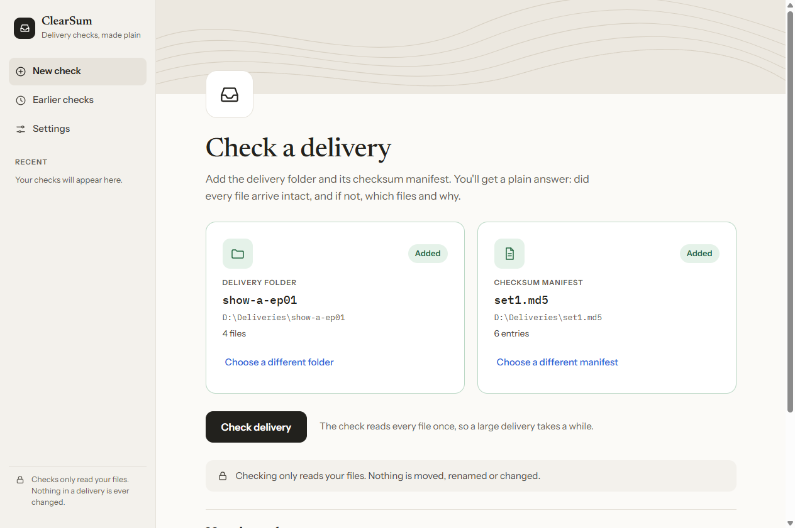
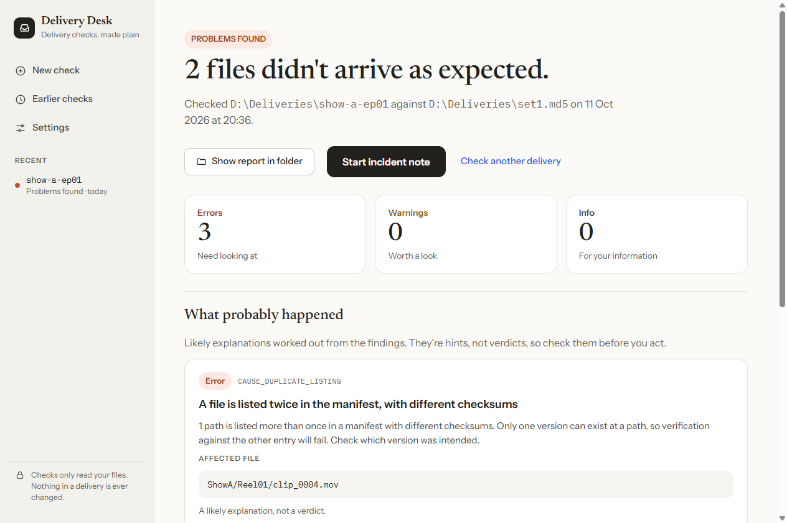
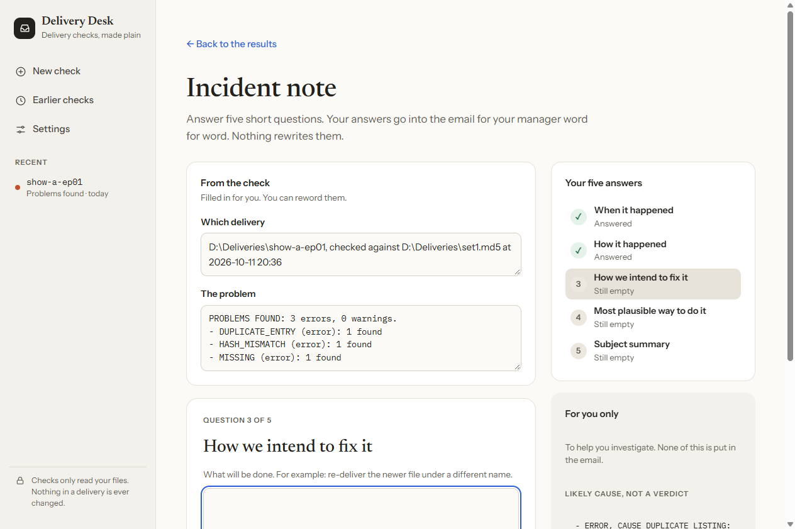
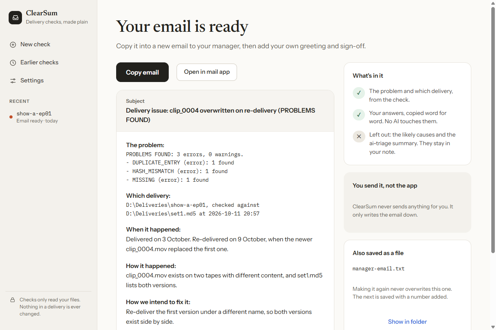
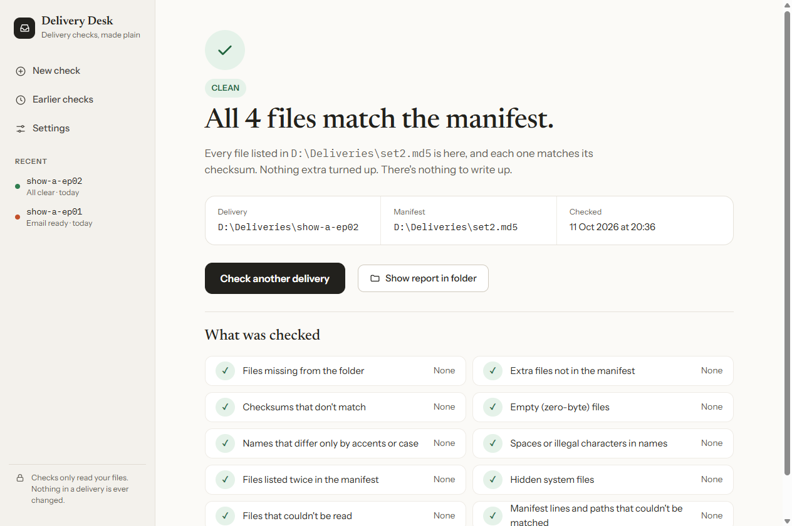
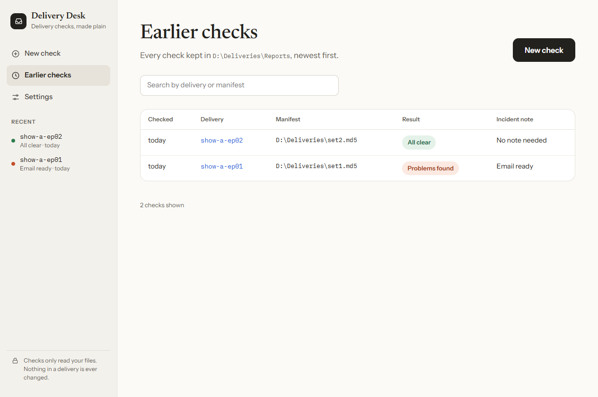

# ClearSum

A calm, drag-and-drop Windows app for checking media deliveries.
- **Add a delivery folder and its checksum manifest.** You get a plain answer: did every file arrive intact, and if not, which files and why.
- **When there are problems,** a short incident note turns your answers into a ready-to-send email for your manager.

It's for anyone who needs delivery checks but isn't comfortable with the command line. The name is a play on *checksum*: the app makes checksum results clear.

ClearSum is the desktop version of [delivery-desk](https://github.com/Georgie995/delivery-desk) and runs the same tested engine.



## What it does

1. **Check.** Drop in, or choose, the delivery folder and its manifest. Every file is compared with its line in the manifest, with real progress and time left. If nothing has been read for 10 minutes (changeable in Settings → Advanced), a warning names the file it's stuck on, in case a drive or network connection has stopped responding. **Stop** is always safe, because checking only reads files.
2. **Read the result**, in plain words:
   - **All clear:** for example "All 1,204 files match the manifest".
   - **Problems found:** for example "2 files didn't arrive as expected", with **what probably happened** (labelled as hints, not verdicts) and every finding, filterable.
   - **"The check couldn't run":** with the reason, in the tools' own words.
3. **Write it up.** Answer five short questions, one at a time:
   - when it happened;
   - how it happened;
   - how you'll fix it;
   - the most plausible way to do it;
   - a subject line.

   Each answer is saved as you go. **Make the email** shows it exactly as it will read. **Copy** it, or **Open in mail app**. The app never sends anything itself.
4. **Pick up where you left off.** **Earlier checks** lists every check, with where its note is up to ("3 of 5 answered", "Email ready").

| Problems found | Incident note | Email ready |
|---|---|---|
|  |  |  |

| All clear | Earlier checks |
|---|---|
|  |  |

*All screenshots: the real app, with synthetic deliveries.*

## Getting it (Windows)

1. Download `ClearSum-0.1.0-windows.zip` from this repository's **Releases**, and unzip it anywhere.
2. Double-click **`ClearSum.exe`** in the unzipped folder. Nothing else needs installing.

**"Windows protected your PC"**: this blue warning appears the first time, because the app isn't digitally signed (a signing certificate is a paid service). Choose **More info → Run anyway**. If you'd rather not, run it from source instead (below).

**The window uses Microsoft Edge WebView2,** which is built into Windows 11 and is already on almost every Windows 10 PC. If the app doesn't display properly, install the "Evergreen" WebView2 Runtime from Microsoft.

### Optional extras (Settings → Advanced)

- **Alerts and log:** if your team runs [delivery-ops-hub](https://github.com/Georgie995/delivery-ops-hub) (n8n), every check is logged and problems raise an alert. Without it, checks still run and every report is still saved.
- **AI summary:** if [ai-triage](https://github.com/Georgie995/ai-triage) is set up, with its own Python, its checked summary appears in the private part of your note. Without it, a code-written summary is used.
- **Secrets** (the webhook secret, the AI key) are typed into password boxes and kept in **Windows Credential Manager**. They are never written into settings, reports, notes or emails, and a saved secret is never shown again.

## Safe by design

- **It never changes a delivery.** Checking only reads files.
- **It never sends anything.** It writes the email down; you send it.
- **It never overwrites your words.** If the note is changed in a text editor while the app is open, the app keeps that edit, shows it, and explains. A second email gets a number added to its name instead of replacing the first.
- **A file name can't take over the app.** Delivery content is always shown as plain text, never as page code. On top of that, the window only runs the app's own scripts (a strict security policy). Tests try names like ``.
- **The window can ask Python for a short, fixed list of actions,** none of which deletes or moves anything. A test fails if one is added without updating it.
- **No network calls of its own.** Pages and fonts are bundled. Only the optional tools reach out: the alert to your n8n, and ai-triage's AI call.

## How it's built

```
PAGES     HTML/CSS/JavaScript, shown in a native window by pywebview (Edge WebView2)
BRIDGE    a small Python class: the only things the pages can ask for
ENGINE    my earlier tools, unchanged in what they decide:
          delivery-desk (the flow, note and email) → manifest-doctor (the check)
          → optionally delivery-ops-hub (alert and log) and ai-triage (AI summary)
```

- [delivery-desk](https://github.com/Georgie995/delivery-desk) is the command-line version of the same flow.
- [manifest-doctor](https://github.com/Georgie995/manifest-doctor) does the checking. It gained an opt-in progress file for this app.
- **The packaged app carries its engine inside it.** When it needs a tool, it starts a copy of itself in "tool mode" (`ClearSum.exe -m manifest_doctor …`), so no separate Python is needed. Only its own two tools can be started this way.

### Running from source, testing and building (for developers)

- **Requirements:** Python 3.11+ on Windows, with [delivery-desk](https://github.com/Georgie995/delivery-desk) and [manifest-doctor](https://github.com/Georgie995/manifest-doctor) cloned next to this folder. Note that manifest-doctor's folder is named `delivery-verify` locally. Add [delivery-ops-hub](https://github.com/Georgie995/delivery-ops-hub) too, for the bundled build.
- **Set up:**
  ```
  python -m venv .venv
  .venv\Scripts\python -m pip install pywebview==6.2.1 keyring==25.7.0 pytest pyinstaller==6.22.3
  ```
- **Run:** `.venv\Scripts\python -m clearsum`, or double-click `run-app.bat`.
- **Test:** `.venv\Scripts\python -m pytest`.
  - **139 tests,** including real checks driven through the real window. Window tests open the app for a few seconds.
  - **Skips:** tests that need the sibling repos or a built app are skipped when those are absent.
  - **Proven by breaking things on purpose:** every protection was broken one at a time, and a test failed each time.
- **Build:** `.venv\Scripts\python packaging\build.py`. It writes the third-party notices, builds with PyInstaller, runs the packaged app's own self-test, and only then zips it.

## Known limits

- **Windows only for now.** Nothing deliberately rules out a Mac, but it has never been built or tested on one.
- **Unsigned:** Windows shows the warning described above.
- **The bundled tools are fixed at build time:** the packaged app carries the versions of manifest-doctor, delivery-desk and delivery-ops-hub it was built with.
- **Alerts waiting in delivery-ops-hub's outbox** (when n8n was unreachable) are resent with delivery-ops-hub's own `resend` command, not from this app.
- **Stop is tested inside the window only with a stand-in engine,** because a tiny real test delivery finishes too fast to stop. Ending a real tool, and the program it started, is tested in the engine.
- **Earlier checks lists the newest 200 checks;** the total is shown.

## Why not just…

- **…use delivery-desk on the command line?** If you're comfortable there, do. This app is for colleagues who aren't, and it runs the same tested engine.
- **…rely on an offload or asset-management tool's own verification?** If your team's tool already checks deliveries against the manifests that come with them and explains failures, use it. ClearSum is for the moment a delivery arrives with its own manifest. It works out *why* files don't match, and helps you write that up for your manager.

## Documentation

- [DESIGN.md](docs/DESIGN.md)
- [DECISIONS.md](docs/DECISIONS.md): every design choice, with alternatives
- [walkthrough.md](docs/walkthrough.md): plain-English explanation of each part

All test data and screenshots are synthetic. No client names, project or tape codes, hostnames or internal paths appear anywhere.

## AI assistance

The code in this repository was written with an AI coding assistant (Claude, by Anthropic). I did not write the Python, HTML, CSS or JavaScript by hand.

What I did:

- **The idea and the audience came from my own work.** I wanted the delivery checks and incident write-ups I built for myself to be usable by colleagues who don't use the command line.
- **I chose the look.** I collected design references, chose the calm "Paper" direction (light only, no dark mode), and approved a clickable prototype made with Claude before any app code was written.
- **I set the requirements:**
  - Windows first;
  - a shortcut while building, then a packaged app;
  - alerts optional;
  - secrets in Windows Credential Manager;
  - real progress while checking;
  - friendly titles on screen, with the codes kept in the email;
  - "Show report in folder";
  - Earlier checks;
  - the rule for which reports folder is used;
  - and, for "Open in mail app", subject only plus the clipboard when an email is too long.
- **I reviewed and approved every friendly title.**
- **I tested the finished app hands-on** before anything was published, including copying the email to the clipboard myself.
- **I approved the design** before any code was written. The decisions are logged in `docs/DECISIONS.md`.

## Licence

[MIT](LICENSE) © 2026 Georgi Stoyanov. The packaged app also carries third-party software under its own licences: see [THIRD-PARTY-NOTICES.txt](packaging/THIRD-PARTY-NOTICES.txt). The bundled fonts (Newsreader, Instrument Sans, IBM Plex Mono) are under the SIL Open Font License 1.1, with their licences in `clearsum/web/fonts`.
